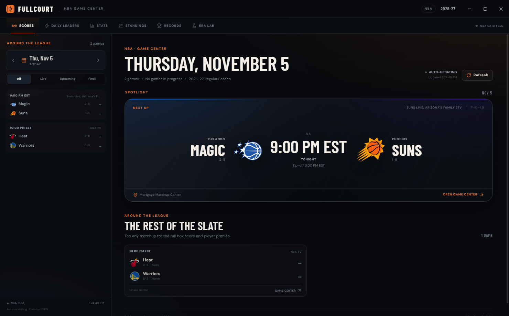
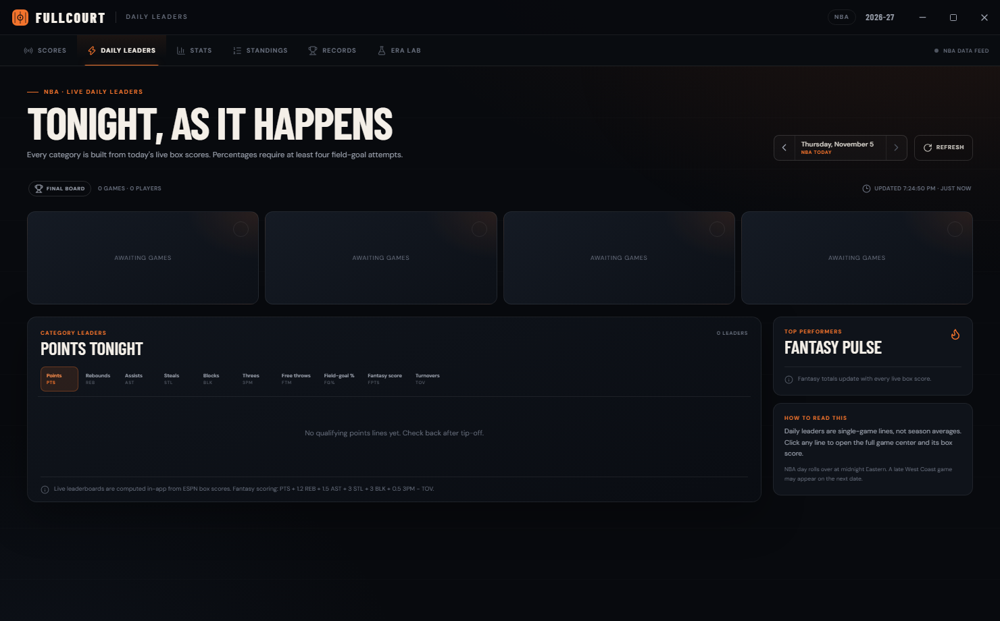
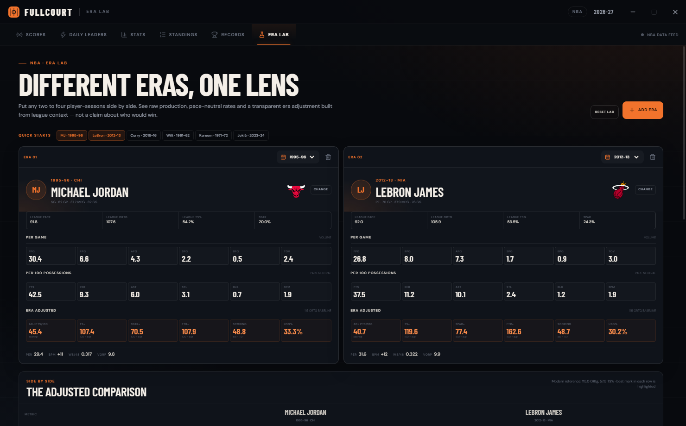
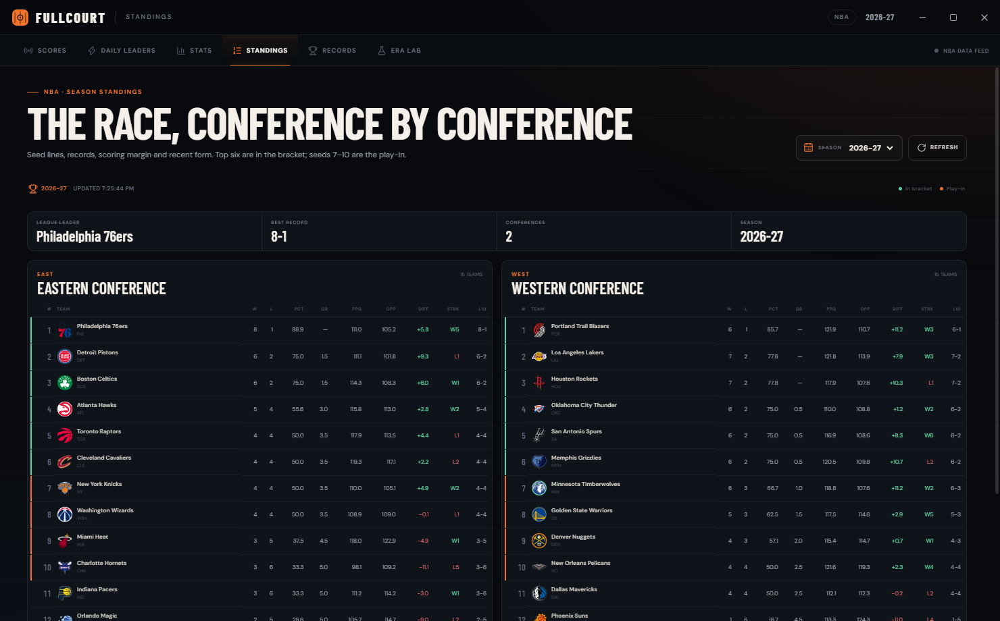
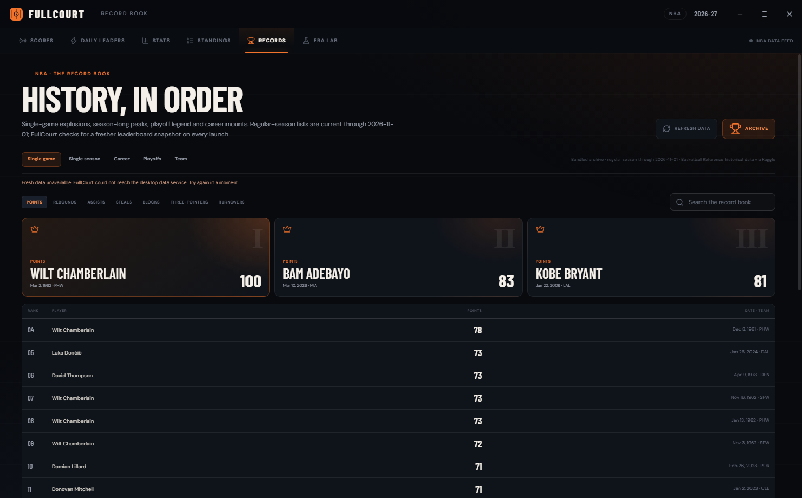
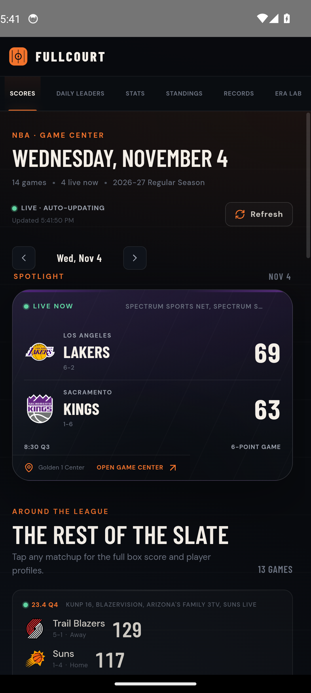
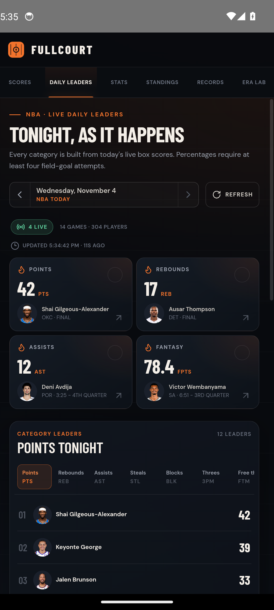
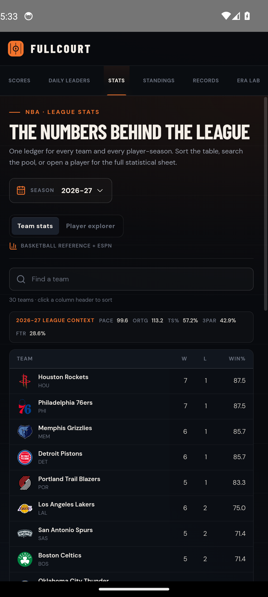
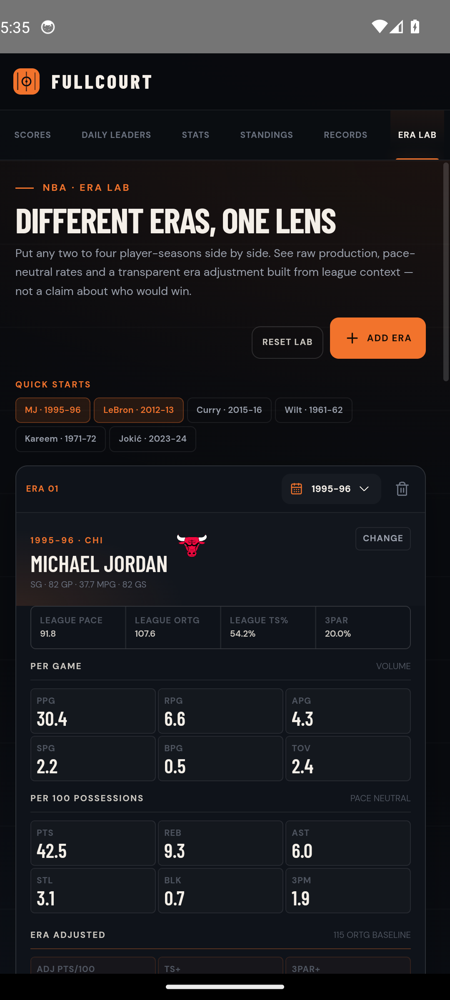

# FullCourt

FullCourt is an NBA command center for Windows and Android. It follows the live slate, opens complete box scores, tracks nightly leaders, and goes deep on league history — team and player tables, standings, a record book, and a side-by-side Era Lab.

Built with Electron, React, Vite, and Capacitor. Live game data comes from ESPN's public JSON feeds. Historical tables and league context come from Basketball Reference. No API keys are required.



## Download

Windows builds are published on the [GitHub Releases page](https://github.com/theclintoris/fullcourt/releases/latest).

- **`FullCourt-Portable-1.2.1.exe`** — single-file portable build; no installation required.
- **`FullCourt-1.2.1-win-x64.zip`** — extract the folder and run `FullCourt.exe`.
- **`FullCourt-Setup-1.2.1.exe`** — standard Windows installer.

The builds are unsigned, so Windows SmartScreen may show a warning on first launch. Choose **More info → Run anyway**, or run `Unblock-File` on the downloaded file. A League Pass subscription is needed to watch games; the button opens the official NBA site.

## What it does

### Game center

- **Around the league** — browse the NBA slate by date, filter live/upcoming/final, and jump back to today.
- **Live spotlight** — the closest live game is promoted automatically, with the full slate underneath. Tip-off times are shown in New Zealand local time (NZDT/NZST); game dates follow the NBA schedule.
- **Live game detail** — team-color hero, score, clock, leaders, venue, officials and broadcast information. A **Watch on League Pass** button opens the official NBA League Pass site for subscribers.
- **Live box score** — traditional and derived advanced columns, team totals, starters/bench, and DNP notes. Live games poll every 12 seconds while the game window is open.
- **Play-by-play** — newest-first possession log with a scoring filter, period grouping, and running score.
- **Player drawer** — current-game line, TS%, eFG%, USG%, AST%, REB%, PIE, Game Score, season averages, advanced rates, last-five sparkline, game log, and bio.

### League desk

- **Daily Leaders** — live top-12 boards for points, rebounds, assists, steals, blocks, threes, free throws, field-goal percentage, turnovers, and fantasy score. Built from the day's live box scores and refreshed while games are in progress.
- **Stats** — sortable, searchable team and player-season tables from 1950 to today. Every displayed column can be sorted; teams include ratings, pace, and four factors, while players include per-game, advanced, and per-100 columns. Click a player row for a full statistical sheet.
- **Standings** — current or historical Eastern/Western conference tables with sortable seeds, records, percentages, games behind, scoring, differential, streaks, and last-ten form. Current-season standings refresh every minute while the app is open. Top six seeds and the 7–10 play-in band are marked.
- **Records** — single-game, single-season, career, playoff, and team record books with category filters and search. Regular-season season/career tables are bundled through November 2026; on launch FullCourt checks Basketball Reference for fresh all-time leaderboards and keeps the last good snapshot with a lossless merge. If the source is rate-limited, the app clearly labels the cached fallback and retries on a later launch.
- **Era Lab** — put two to four player-seasons side by side. Compare raw per-game production, per-100 possession rates, advanced metrics, and transparent era-adjusted scoring and efficiency indexes.

Advanced game metrics are derived locally. Era adjustments are experimental and clearly labeled; they are context, not a claim about who would win.

## Screens

| Daily Leaders | Era Lab |
| --- | --- |
|  |  |

| Standings | Records |
| --- | --- |
|  |  |

| Android — Scores | Android — Daily Leaders |
| --- | --- |
|  |  |

| Android — Stats | Android — Era Lab |
| --- | --- |
|  |  |

More captures are in [`screenshots/`](screenshots/).

## Run locally

Requirements: Node.js 20+ and npm.

```bash
npm install
npm start
```

`npm start` builds the renderer and launches the desktop app. To launch an already-built app:

```bash
npm run app
```

## Test

```bash
npm test
```

The offline suite covers advanced-stat formulas, PIE distribution, box-score sorting, ESPN normalizers, season helpers, era math, daily-leader aggregation, Basketball Reference table parsing, and standings parsing. It does not require network access.

## Build a Windows release

```bash
npm run installer   # NSIS installer
npm run portable    # single portable .exe
npm run dist        # both
```

Artifacts are written to `release/`:

- `FullCourt-Setup-1.2.1.exe`
- `FullCourt-Portable-1.2.1.exe`
- `FullCourt-1.2.1-win-x64.zip` — unpack-and-run folder build (most portable option)

The Windows release is unsigned, so Windows SmartScreen may warn on first launch.

## Build the Android app

The Android target is a Capacitor wrapper around the same React UI. It talks to ESPN and Basketball Reference through a native HTTP adapter, so the renderer keeps its strict CSP.

Requirements: JDK 21 and Android SDK platform 35 with build-tools 34.0.0. Add your signing key details to `android/keystore.properties` (ignored by git), then:

```bash
npm run build
npx cap copy android
cd android
./gradlew.bat assembleRelease --no-daemon
```

The APK is written to `android/app/build/outputs/apk/release/app-release.apk`. This Windows release does not include a rebuilt Android package. Android will require enabling installs from your browser/file manager the first time. The app targets Android 7.0+ (API 23) and requests network access only.

## Data

Live game data:

- `site.api.espn.com/apis/site/v2/sports/basketball/nba/scoreboard`
- `site.api.espn.com/apis/site/v2/sports/basketball/nba/summary?event=…`
- `site.web.api.espn.com/apis/common/v3/sports/basketball/nba/athletes/…`
- `site.web.api.espn.com/apis/v2/sports/basketball/nba/standings`

Historical team/player tables and league context:

- `basketball-reference.com` season and player tables, fetched on demand by the Electron main process

Record book:

- a current bundled Basketball Reference baseline (regular-season season and career lists through 2026-11-01, scoring through March 2026) plus a launch-time refresh of the full all-time leaderboards
- curated team records

The renderer has no network access. HTML runs behind a strict CSP, `connect-src` is disabled, and all live requests pass through context-isolated preload IPC. Responses are cached in the main process with stale-cache fallback when a feed is unavailable. Basketball Reference rate limits are respected with a serial request queue. On Android, the same service bundle runs inside the app and routes requests through Capacitor's native HTTP bridge; no browser CORS permission is used.

FullCourt is not affiliated with the NBA, ESPN, Basketball Reference, or Kaggle. Team names, logos, and player images belong to their respective owners.

## Project layout

```text
electron/
  main.cjs            Electron window, IPC, external-link and permission policy
  preload.cjs         window.fullcourt bridge
  nba-service.cjs     ESPN fetch, normalization, caching, live game/player DTOs
  league-service.cjs  BBR team/player tables, standings, daily leaders, era context
src/
  App.jsx             App shell and page routing
  components/         Game center, league pages, tables, drawer, Era Lab
  hooks/              Live scoreboard/game polling and league-data hooks
  lib/                API bridge, formatting, advanced-stat engine, era math
  data/records.json   Packaged record-book snapshot
  styles/             League-page styles loaded after the base visual system
  mobile/             Capacitor bridge and generated service bundle
scripts/
  capture.cjs         Game-center screenshot smoke test
  capture-league.cjs  League-page screenshot smoke test with local fixtures or live data
  build-records-kaggle.py
  build-mobile-service.mjs
  make-icon.py
  verify-packaged.mjs Packaged Windows smoke test
tests/                Node test runner suites
android/              Generated Capacitor Android project
build/                App icons
```

## Notes and limitations

- Live scoreboard polling runs every 20 seconds while the app is visible and a live game exists. Daily Leaders polls every 30 seconds while games are live. Open game detail polls every 12 seconds while live and every 30 seconds before tip-off.
- Historical stats depend on Basketball Reference being reachable. When it rate-limits or is unavailable, FullCourt shows the error and retains any cached response; it does not invent numbers.
- The record book ships with a current baseline and refreshes its 42 all-time leaderboards from Basketball Reference on launch when the source is available. If the source is rate-limited, the app labels the last good snapshot and retries on a later launch. Regular-season single-season and career lists are current through 2026-11-01; playoff lists are the last archived 2023-24 snapshot until a live refresh succeeds.
- ESPN occasionally publishes placeholder or delayed data; FullCourt presents the feed as-is and marks the last update time.
- Official player-tracking data (synergy, hustle, shot charts) is not available from the public sources used here.
- The desktop app targets Windows x64 with NSIS and portable builds. The Android project targets API 23+ and can be packaged as a self-signed APK for sideloading.
